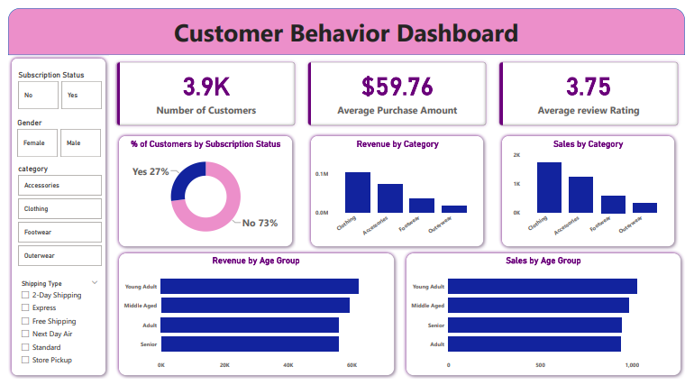

# Customer Shopping Behavior Analysis

**Author:** Shreesha Shetty  
**Domain:** Retail Analytics & Business Intelligence  
**Tech Stack:** Python (Pandas, NumPy, SQLAlchemy), MySQL, Power BI, Excel, Git  

---

## 📊 1. Project Overview

This project delivers an end-to-end data analytics solution evaluating consumer purchasing patterns across **3,900 retail transactions**. The core objective of this project is to build an ingestion and transformation script in Python, persist structured records into a relational MySQL database, execute targeted business SQL queries to identify revenue drivers and customer attrition risks, and deliver an executive Power BI dashboard for interactive stakeholder decision-making.

### Key Business Questions Solved:
1. **Demographic Revenue Split:** What demographic segments represent the largest revenue contribution and average order value?
2. **Customer Retention & Loyalty:** How does customer order history correlate with retention, and how large is the loyal customer base?
3. **Logistics & Fulfillment Spend:** Does fulfillment preference (e.g., Express vs. Standard shipping) impact transaction size?
4. **Promotional Exposure:** What product categories suffer from discount dependency and margin decay?
5. **Subscription Opportunities:** How large is the subscription adoption gap, and where can conversion playbooks be deployed?

---

## 📂 2. Repository File Architecture

```text
├── Customer_Shopping_Behaviour_Analysis.ipynb   # Python ETL, data cleaning, and MySQL ingestion script
├── Customer_Shopping_Behavior.sql              # Production SQL queries and analytical aggregations
├── Customer_Behavior_Dashboard.pbix            # Native Power BI report file with data models and DAX
├── customer_shopping_behavior.csv              # Standardized, cleaned dataset used for reporting
├── Customer Shopping Behavior Analysis.pdf     # Executive project slide deck and summary findings
├── dashboard.png                               # Screenshot preview of the Power BI dashboard layer
└── README.md                                   # Comprehensive project documentation
```

---

## 🛠️ 3. Technology Stack & Environment

| Layer | Tools / Libraries | Purpose |
| :--- | :--- | :--- |
| **Data Processing & ETL** | Python 3.10+, Pandas, NumPy | Data auditing, category-median imputation, feature engineering |
| **Relational Database** | MySQL Server 8.0, SQLAlchemy, PyMySQL | Data modeling, schema enforcement, complex business queries |
| **Business Intelligence** | Microsoft Power BI Desktop, DAX | Metric card modeling, interactive multi-slicer visualizations |
| **Documentation & Control** | Git, GitHub, Markdown | Version control and portfolio documentation |

---

## 🐍 4. Data Preprocessing & Ingestion Script (Python)

The ingestion workflow was executed in Jupyter Notebook to transform raw, semi-structured records into clean relational data ready for database ingestion:

* **Data Profiling & Schema Inspection:** Evaluated null distributions, memory footprint, and data types across 3,900 records using `df.info()` and summary statistics.
* **Missing Value Imputation:** Handled 37 missing values localized in the `review_rating` feature by calculating and applying the median review score grouped by individual `category` partitions:
  ```python
  df['review_rating'] = df.groupby('category')['review_rating'].transform(
      lambda x: x.fillna(x.median())
  )
  ```
* **Schema Standardization:** Converted all raw column headers into lowercase `snake_case` naming conventions for MySQL query optimization.
* **Feature Engineering:**
  * Created an `age_group` attribute binned into demographic cohorts: `Young Adult (18-35)`, `Middle-Aged (36-50)`, and `Senior (51+)`.
  * Standardized `purchase_frequency` intervals into quantitative frequency indicators.
* **Redundancy Auditing:** Evaluated correlation between `discount_applied` and `promo_code_used`, removing redundant features to maintain database 3NF integrity.
* **Relational Database Loading:** Ingested the structured DataFrame directly into a local MySQL instance using an active SQLAlchemy engine interface:
  ```python
  from sqlalchemy import create_engine

  engine = create_engine("mysql+pymysql://root:<password>@localhost:3306/customer_analytics")
  df.to_sql('shopping_behavior', con=engine, if_exists='replace', index=False)
  ```

---

## 🗄️ 5. Relational Database Queries & Analytical Findings (SQL)

Once records were loaded into MySQL, advanced SQL queries were designed to extract high-priority commercial insights:

### 1. Demographic Revenue Distribution
Evaluated total sales volume and average order spend across gender segments:
```sql
SELECT 
    gender, 
    COUNT(customer_id) AS total_transactions,
    ROUND(SUM(purchase_amount), 2) AS total_revenue,
    ROUND(AVG(purchase_amount), 2) AS avg_order_value
FROM shopping_behavior 
GROUP BY gender;
```
* **Finding:** Male consumers generated **$157,890** across 2,652 transactions (AOV: $59.54), whereas female consumers contributed **$75,191** across 1,248 transactions (AOV: $60.25).

### 2. Behavioral Funnel & Customer Loyalty Segmentation
Categorized customer cohorts by historical engagement to isolate repeat retention:
```sql
SELECT 
    customer_tier,
    COUNT(customer_id) AS customer_count,
    ROUND(COUNT(customer_id) * 100.0 / (SELECT COUNT(*) FROM shopping_behavior), 2) AS cohort_percentage,
    ROUND(AVG(purchase_amount), 2) AS avg_spend
FROM (
    SELECT 
        customer_id,
        purchase_amount,
        CASE 
            WHEN previous_purchases = 0 THEN 'New Customer'
            WHEN previous_purchases BETWEEN 1 AND 10 THEN 'Returning Customer'
            ELSE 'Loyal Customer'
        END AS customer_tier
    FROM shopping_behavior
) AS segmentation_table
GROUP BY customer_tier
ORDER BY customer_count DESC;
```
* **Finding:** The business has an established core of **3,116 Loyal Customers (79.9%)** and **701 Returning Customers (18.0%)**, with only **83 New Customers (2.1%)**, indicating strong baseline retention but a slow top-of-funnel acquisition rate.

### 3. Fulfillment Tier Spend Variance
Assessed spend delta across logistics channels to evaluate customer willingness to pay for delivery:
```sql
SELECT 
    shipping_type, 
    COUNT(customer_id) AS order_volume,
    ROUND(AVG(purchase_amount), 2) AS avg_spend
FROM shopping_behavior
GROUP BY shipping_type
ORDER BY avg_spend DESC;
```
* **Finding:** Customers utilizing **Express Shipping** generated an average order value of **$60.48**, compared to **$58.46** for Standard shipping—representing an average premium spend of **+$2.02 per order** for expedited fulfillment.

### 4. High-Discount Category Exposure
Identified products with heavy discount dependency to detect margin risk:
```sql
SELECT 
    category,
    item_purchased,
    COUNT(*) AS units_sold,
    ROUND(SUM(CASE WHEN discount_applied = 'Yes' THEN 1 ELSE 0 END) * 100.0 / COUNT(*), 2) AS discount_penetration_rate
FROM shopping_behavior
GROUP BY category, item_purchased
HAVING discount_penetration_rate >= 45.00
ORDER BY discount_penetration_rate DESC;
```
* **Finding:** Certain apparel and accessory items (e.g., Hats at **50.0% promotional discount reliance**) rely excessively on promotional incentives, creating gross margin vulnerability.

### 5. Subscription Adoption Gap
Quantified the subscription funnel penetration:
```sql
SELECT 
    subscription_status,
    COUNT(customer_id) AS total_users,
    ROUND(COUNT(customer_id) * 100.0 / (SELECT COUNT(*) FROM shopping_behavior), 2) AS penetration_pct,
    ROUND(AVG(purchase_amount), 2) AS avg_spend
FROM shopping_behavior
GROUP BY subscription_status;
```
* **Finding:** **73% of customers (2,847 users)** are non-subscribers despite maintaining repeat purchasing behavior, representing an unmonetized subscription revenue opportunity.

---

## 📈 6. Power BI Executive Dashboard

The interactive Power BI dashboard translates these analytical findings into an executive monitoring interface:



### Key Performance Indicators Tracked:
* **Total Customer Records:** 3,900
* **Baseline Average Purchase Amount (AOV):** $59.76
* **Average Review Rating:** 3.75 / 5.00
* **Active Subscriber Rate:** 27% (1,053 Users) vs. Non-Subscribers: 73% (2,847 Users)
* **Interactive Dynamic Slicers:** Cross-filtering across Age Groups, Product Categories, Seasons, and Shipping Types.

---

## 💡 7. Strategic Recommendations & Business Playbook

1. **Monetize the 73% Non-Subscriber Pool:**  
   Launch a targeted onboarding incentive for repeat buyers in the returning cohort (701 users), providing free shipping or first-order perks to convert them into recurring members.
2. **Promote Premium Delivery Options:**  
   Because Express Shipping orders exhibit a higher average spend ($60.48 vs $58.46), introduce a low-barrier cart threshold (e.g., *"Spend $65 for discounted Express Delivery"*) to naturally lift basket size.
3. **Mitigate Discount Reliance:**  
   Re-evaluate promotional frequency on margin-sensitive items like Hats (currently at 50% discount penetration) by replacing direct price cuts with tiered volume bundles (e.g., *"Buy 2, Get 15% Off"*).

---

## 🚀 8. Reproduction & Setup Guide

### Prerequisites
* Python 3.9+ with `pip`
* MySQL Server 8.0+ running locally on port `3306`
* Microsoft Power BI Desktop

### 1. Clone the Repository
```bash
git clone https://github.com/shreeshashetty/Customer-Shopping-Behavior-Analysis.git
cd Customer-Shopping-Behavior-Analysis
```

### 2. Environment Setup & Data Ingestion
Install required Python libraries:
```bash
pip install pandas numpy sqlalchemy pymysql jupyter
```
Launch the notebook and execute all cells to process the data and load the tables into MySQL:
```bash
jupyter notebook Customer_Shopping_Behaviour_Analysis.ipynb
```

### 3. Run Database Queries
Open `Customer_Shopping_Behavior.sql` in MySQL Workbench, DBeaver, or command line to execute the queries against your database:
```bash
mysql -u root -p customer_analytics < Customer_Shopping_Behavior.sql
```

### 4. View Dashboard
Open `Customer_Behavior_Dashboard.pbix` in Power BI Desktop. To point the dashboard to your local files:
1. Navigate to **Home** > **Transform Data** > **Data Source Settings**.
2. Update the path to your local `customer_shopping_behavior.csv` or local MySQL instance and click **Close & Apply**.